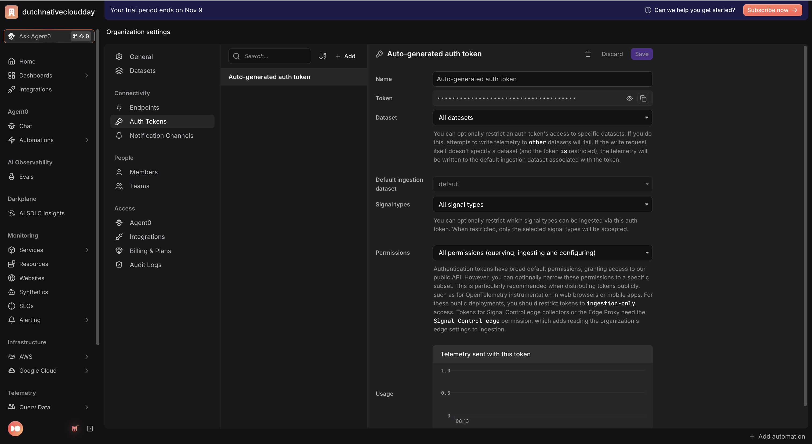
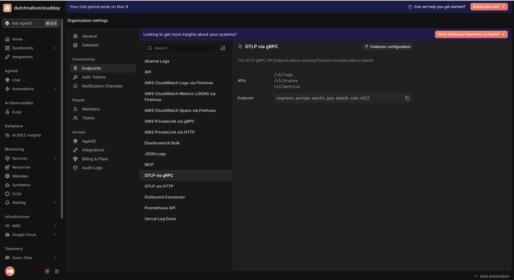

# Dutch Cloud Native Day — From One Request to One Trace

Hands-on OpenTelemetry workshop companion apps.

Each folder under [`apps/`](apps/) is the **same registration app for Dutch
Cloud Native Day**, implemented in a different language. Pick the stack you're
comfortable with — they all behave identically, send traces to
[Dash0](https://www.dash0.com), and produce the same kind of distributed trace.

| App | Stack | Instrumentation |
|-----|-------|-----------------|
| [`apps/nodejs`](apps/nodejs) | Node.js + Express | `@opentelemetry/sdk-node` auto-instrumentation |
| [`apps/python`](apps/python) | Python + Flask | OpenTelemetry Python SDK (Flask + requests instrumentors) |
| [`apps/go`](apps/go) | Go + `net/http` | OpenTelemetry Go SDK + `otelhttp` |
| [`apps/java`](apps/java) | Java + Spring Boot | OpenTelemetry Java agent (`-javaagent`) |

Every app is **two services** — a web frontend (the registration form) and a
backend API (does the work) — so a single registration becomes one end-to-end
distributed trace across two services. See [`apps/SPEC.md`](apps/SPEC.md) for the
shared contract (ports, service names, span layout, the deliberate failures).

## 0. Get a Dash0 account

**"The Dash0 app"** is Dash0's web UI at **[app.dash0.com](https://app.dash0.com)** —
the dashboard where the telemetry your apps send shows up (your service names,
traces, metrics and logs).

To get in: sign up at **[dash0.com](https://www.dash0.com)**, which creates your
organization and logs you into `app.dash0.com`. Everything in step 1 below (auth
token, endpoint) comes from inside that app.

**Cost:** Dash0 offers a **14-day free trial with no credit card required** and
full access to every feature, which is all you need for this workshop. Dash0 is otherwise a paid,
usage-based product (there is no permanent free tier), so the trial expires after
14 days. Check [dash0.com/pricing](https://www.dash0.com/pricing) for current
terms.

## 1. Get your Dash0 credentials (once)

1. In the Dash0 app, click the name of your organization in the top left and then click **Settings**.

2. Go to **Settings → Auth Tokens** and create a token or use 
the **Auto-generated auth token**. It looks like `auth_...`.
   <p></p>

3. Go to the **Settings → Endpoints → OTLP via gRPC** to find your fully-resolved
   OTLP ingress endpoint (it's region-specific, e.g.
   `https://ingress.eu-west-1.aws.dash0.com`).
   <p></p>

4. Copy the template and paste both values in:

   ```bash
   cp .env.example .env
   ```

   This is the full [`.env.example`](.env.example). Edit your `.env` and set:

   - `OTEL_EXPORTER_OTLP_ENDPOINT` → your OTLP ingress endpoint from step 2.
   - `DASH0_AUTH_TOKEN` → the `auth_...` token from step 1 (replace `auth_REPLACE_ME`).
   - `DASH0_DATASET` → leave as `default` unless you target a different dataset.

   ```bash
   # Dash0 credentials — shared by every app in this repo.
   # Copy this file to `.env` and fill in the values from your Dash0 org.
   #
   #   cp .env.example .env
   #
   # 1) Auth token:  Dash0 app → Settings → Auth Tokens → create a token (auth_...).
   # 2) OTLP endpoint: Dash0 app → Integration Hub → "OpenTelemetry" shows your
   #    fully-resolved ingress URL (region-specific), e.g.
   #    https://ingress.eu-west-1.aws.dash0.com
   #
   # Each app reads these via its run.sh. Node/Python/Go set the OTLP auth headers
   # in code from DASH0_AUTH_TOKEN/DASH0_DATASET (robust across SDKs); the Java
   # agent builds OTEL_EXPORTER_OTLP_HEADERS from them in its run.sh.

   # Standard OpenTelemetry OTLP settings (vendor-neutral):
   OTEL_EXPORTER_OTLP_ENDPOINT=https://ingress.eu-west-1.aws.dash0.com
   OTEL_EXPORTER_OTLP_PROTOCOL=http/protobuf

   # Your Dash0 token and target dataset ("default" is auto-created):
   DASH0_AUTH_TOKEN=auth_REPLACE_ME
   DASH0_DATASET=default
   ```

All four apps read this same root `.env`. You only do this once.

## 2. Run an app

Open its folder's README and follow the steps — each is zero-to-trace in a few
commands:

- [Node.js](apps/nodejs/README.md)
- [Python](apps/python/README.md)
- [Go](apps/go/README.md)
- [Java](apps/java/README.md)

You start the backend, start the frontend, open the frontend in a browser, and
submit the form. Because the ports differ per language, you can run several apps
side by side.

## 3. See it in Dash0

The app you ran is **two local services** on your own machine: a **frontend**
(serves the form, e.g. `http://localhost:3000`) and a **backend** (the API that
validates and saves the registration). **Dash0 is separate** — it's the
observability platform both services export their telemetry to, where you'll
view it.

Open the frontend in your browser, fill in the registration form, and click
submit once. That single submission sends a request from your frontend service
to your backend service, and both services send the resulting telemetry up to
Dash0.

**How that telemetry reaches Dash0:** each service starts with the OpenTelemetry
SDK/agent loaded (Node `-r ./tracing.js`, Python `otel_setup.py`, the Go SDK, or
the Java agent). As requests run, the SDK records spans, metrics, and logs and
its **OTLP exporter** batches them and pushes them over OTLP (`http/protobuf`)
straight to the `OTEL_EXPORTER_OTLP_ENDPOINT` you configured, attaching your
`Authorization: Bearer <token>` and `Dash0-Dataset` headers. The frontend and
backend are each configured independently (every `run.sh` sources the same root
`.env`), so each exports its own telemetry directly to Dash0 — there's no local
collector in between.

Then look in Dash0 for the two service names of the app you ran (e.g.
`registration-web-node` and `registration-api-node`). Open a trace and
you'll see the request flow from the web service into the API, with child spans
for `validate-registration`, `save-registration`, and `send-confirmation-email`.

All three signals flow:
- **Traces** — the end-to-end request across both services.
- **Metrics** — a `registration.duration` histogram, split by `ticket_type`
  and `error.type`, with deliberately **bounded** attributes so the metric
  can't explode in cardinality (a key workshop talking point).
- **Logs** — each failure is also emitted as a log record, correlated to its
  trace so Dash0 links the two.

## 4. Investigate the deliberate failures

Each app classifies failures with a bounded `error.type` and a matching HTTP
status, so you can tell a client mistake apart from a service outage:

- **Bad recipient (client error → `422`):** register with an email containing
  `+fail`, e.g. `ada+fail@example.com`. `send-confirmation-email` fails with
  `error.type=invalid_recipient`. Deterministic — trigger it on demand.
- **Provider outage (server error → `503`):** ~15% of registrations fail at
  random with `error.type=email_provider_unavailable`. Same span, different
  cause — compare the two in Dash0.
- **Validation error (`400`):** empty fields or a ticket type outside
  `standard`/`workshop`/`vip` are rejected at `validate-registration`
  (`error.type=validation_error` / `unknown_ticket_type`) — the registration
  never reaches the "database", keeping that attribute bounded by construction.
- **Latency outlier:** `save-registration` occasionally takes 400–700 ms
  (simulated slow query). Hunt the slow trace, or spot it in the duration metric.

This mirrors a real incident investigation: start from one failed request, open
its trace, read the `error.type` on the failing span, and confirm against the
metric whether it's a one-off or a pattern.

---

> Workshop: **From One Request to One Trace: Hands-On OpenTelemetry** —
> Geertjan Wielenga / Aakansha Priya (Dash0), Dutch Cloud Native Day.
